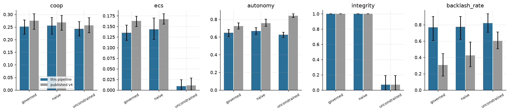

Backbone: `Qwen/Qwen3-235B-A22B-Instruct-2507`; 15 runs.

| condition | metric | ours | ours_lo | ours_hi | published | pub_lo | pub_hi | overlap |
|---|---|---|---|---|---|---|---|---|
| governed | coop_final | 0.252 | 0.222 | 0.278 | 0.275 | 0.241 | 0.302 | True |
| governed | ecs_final | 0.135 | 0.117 | 0.153 | 0.163 | 0.150 | 0.174 | True |
| governed | autonomy_final | 0.648 | 0.604 | 0.684 | 0.724 | 0.690 | 0.761 | False |
| governed | integrity_final | 1.000 | 1.000 | 1.000 | 1.000 | 1.000 | 1.000 | True |
| governed | backlash_rate_final | 0.768 | 0.605 | 0.900 | 0.308 | 0.172 | 0.445 | False |
| naive | coop_final | 0.256 | 0.222 | 0.288 | 0.269 | 0.237 | 0.295 | True |
| naive | ecs_final | 0.143 | 0.119 | 0.170 | 0.167 | 0.156 | 0.180 | True |
| naive | autonomy_final | 0.668 | 0.628 | 0.708 | 0.757 | 0.722 | 0.801 | False |
| naive | integrity_final | 1.000 | 1.000 | 1.000 | 1.000 | 1.000 | 1.000 | True |
| naive | backlash_rate_final | 0.773 | 0.620 | 0.900 | 0.423 | 0.287 | 0.587 | False |
| unconstrained | coop_final | 0.243 | 0.215 | 0.271 | 0.257 | 0.228 | 0.287 | True |
| unconstrained | ecs_final | 0.009 | 0.000 | 0.024 | 0.011 | 0.000 | 0.028 | True |
| unconstrained | autonomy_final | 0.627 | 0.597 | 0.655 | 0.842 | 0.821 | 0.862 | False |
| unconstrained | integrity_final | 0.070 | 0.000 | 0.190 | 0.070 | 0.000 | 0.190 | True |
| unconstrained | backlash_rate_final | 0.820 | 0.707 | 0.933 | 0.603 | 0.505 | 0.712 | True |

- Paired ECS gap governed − unconstrained: +0.126 [+0.098, +0.151] (published ≈ +0.17).
- CI overlap with published values on 67% of condition×metric cells.

