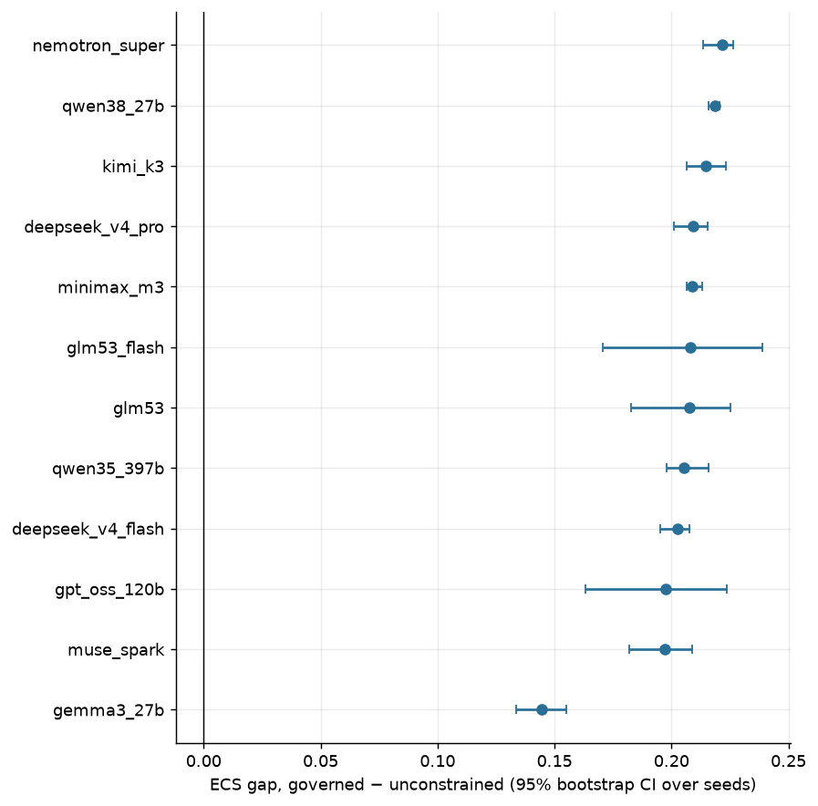

| alias | n_seeds | ecs_gap | ecs_gap_lo | ecs_gap_hi | coop_gap | autonomy_gap | backlash_gov | backlash_unc | cost_usd |
|---|---|---|---|---|---|---|---|---|---|
| nemotron_super | 3 | 0.222 | 0.214 | 0.226 | -0.004 | -0.010 | 0.000 | 0.000 | 0.427 |
| qwen38_27b | 3 | 0.219 | 0.216 | 0.221 | 0.001 | 0.031 | 0.006 | 0.422 | 0.773 |
| kimi_k3 | 3 | 0.215 | 0.206 | 0.223 | -0.007 | 0.093 | 0.000 | 0.339 | 5.655 |
| qwen35_397b | 2 | 0.209 | 0.202 | 0.216 | 0.032 | 0.360 | 0.108 | 1.000 | 0.850 |
| deepseek_v4_pro | 3 | 0.209 | 0.201 | 0.215 | -0.004 | 0.032 | 0.011 | 0.306 | 1.313 |
| minimax_m3 | 3 | 0.209 | 0.207 | 0.213 | 0.015 | 0.047 | 0.197 | 0.758 | 1.236 |
| glm53 | 3 | 0.208 | 0.183 | 0.225 | 0.001 | -0.005 | 0.003 | 0.206 | 1.317 |
| deepseek_v4_flash | 3 | 0.203 | 0.195 | 0.208 | 0.006 | -0.059 | 0.000 | 0.175 | 0.394 |
| gpt_oss_120b | 3 | 0.197 | 0.163 | 0.224 | 0.002 | 0.040 | 0.067 | 0.586 | 0.348 |
| gemma3_27b | 3 | 0.145 | 0.134 | 0.155 | 0.003 | 0.110 | 0.028 | 0.764 | 0.122 |

- ECS advantage of governance with CI above zero for **10/10** model families.
- Autonomy paradox (governed autonomy < unconstrained) in 3/10 families.

