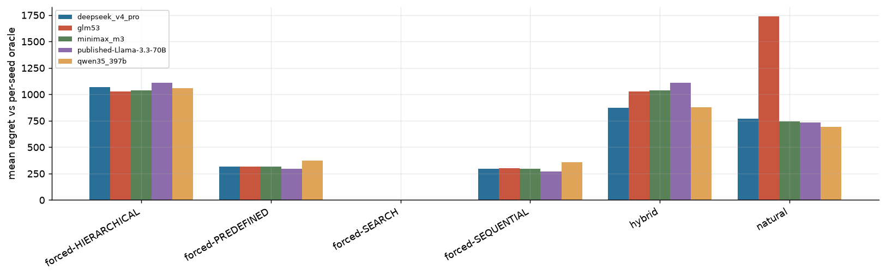

| policy | deepseek_v4_pro | glm53 | minimax_m3 | published-Llama-3.3-70B | qwen35_397b |
|---|---|---|---|---|---|
| forced-HIERARCHICAL | 1069.600 | 1029.800 | 1039.200 | 1110.800 | 1097.900 |
| forced-PREDEFINED | 318.000 | 316.800 | 315.700 | 293.600 | 419.200 |
| forced-SEARCH | 0.000 | 0.000 | 0.000 | 0.000 | 0.000 |
| forced-SEQUENTIAL | 296.000 | 300.100 | 294.100 | 272.300 | 405.500 |
| hybrid | 875.300 | 1029.800 | 1039.200 | 1110.800 | 1097.900 |
| natural | 772.300 | 1739.100 | 746.300 | 734.400 | 762.500 |

- Oracle (best forced) modes across model×seed: {'SEARCH': 19}

