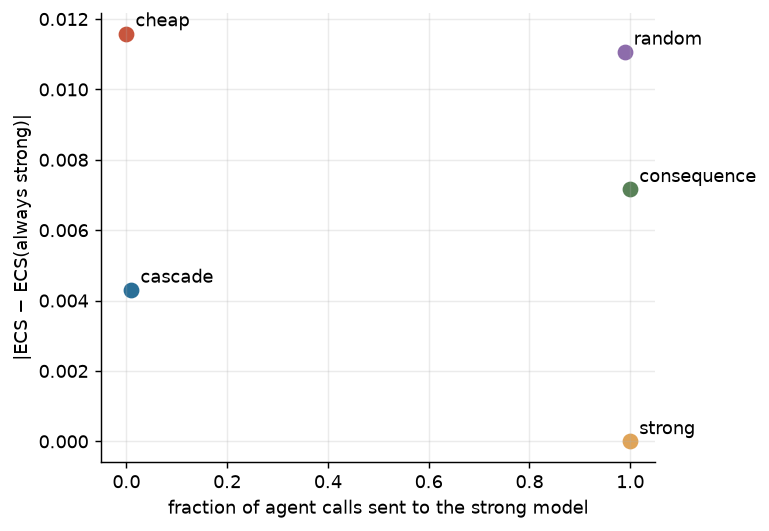

| policy | n | strong_frac | cost | ecs | coop | ecs_abs_err | coop_traj_mad |
|---|---|---|---|---|---|---|---|
| cascade | 3 | 0.010 | 0.024 | 0.217 | 0.271 | 0.004 | 0.014 |
| cheap | 3 | 0.000 | 0.026 | 0.212 | 0.259 | 0.012 | 0.026 |
| consequence | 3 | 1.000 | 0.003 | 0.210 | 0.278 | 0.007 | 0.004 |
| random | 3 | 0.989 | 0.070 | 0.206 | 0.275 | 0.011 | 0.008 |
| strong | 3 | 1.000 | 0.059 | 0.217 | 0.282 | 0.000 | 0.000 |

- Fidelity is measured against the always-strong run on the same seed (common random numbers).

