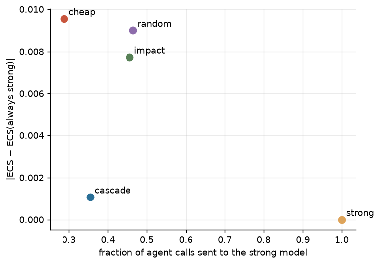

| policy | n | strong_frac | cost_rel | ecs | coop | ecs_abs_err | coop_traj_mad |
|---|---|---|---|---|---|---|---|
| cascade | 2 | 0.068 | 0.355 | 0.203 | 0.271 | 0.001 | 0.018 |
| cheap | 2 | 0.000 | 0.288 | 0.212 | 0.272 | 0.010 | 0.024 |
| impact | 2 | 0.237 | 0.456 | 0.207 | 0.273 | 0.008 | 0.017 |
| random | 2 | 0.252 | 0.465 | 0.210 | 0.266 | 0.009 | 0.025 |
| strong | 2 | 1.000 | 1.000 | 0.203 | 0.276 | 0.000 | 0.000 |

- Tiers: cheap `deepseek-ai/DeepSeek-V4.1-Flash`, strong `deepseek-ai/DeepSeek-V4-Pro-0813`. cost_rel = observed-token cost of all agent calls (cache hits included) relative to always-strong on the same seed.
- Fidelity (ecs_abs_err, coop_traj_mad) is vs always-strong on the same seed; routing changes later states, so it measures trajectory divergence, not per-call agreement.
- Does the strong tier matter? ECS strong − cheap (paired over seeds): -0.009 [-0.018, +0.001]. If this interval covers 0, routing cannot show value on this outcome.
- Trajectory error, random − impact (paired; > 0 favours impact): +0.008 [+0.001, +0.016].

