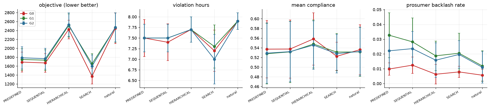

150 cells done over 10 backbone x seed blocks (backbones: deepseek_v4_pro, glm53).

**Cell means** (all backbones)

| plan | G0 | G1 | G2 |
|---|---|---|---|
| HIERARCHICAL | 2422.2 | 2511.3 | 2530.5 |
| PREDEFINED | 1689.9 | 1749.4 | 1785.9 |
| SEARCH | 1372.5 | 1650.0 | 1598.8 |
| SEQUENTIAL | 1670.6 | 1732.6 | 1766.4 |
| natural | 2447.7 | 2466.2 | 2469.4 |
_objective (lower is better)_

**Governance trade-off** (objective lower = better; integrity = judge-rated share of clean messages, valid judgements only, with bounds counting unresolved judgements as fail / pass)

| plan | gov | objective | violation_hours | integrity | integrity_lo | integrity_hi | content_integrity | urgency_framing | curtail_gini | judge_invalid |
|---|---|---|---|---|---|---|---|---|---|---|
| HIERARCHICAL | G0 | 2422.219 | 7.700 | 0.449 | 0.396 | 0.475 | 0.961 | 0.551 | 0.581 | 0.079 |
| HIERARCHICAL | G1 | 2511.316 | 7.700 | 0.839 | 0.762 | 0.842 | 1.000 | 0.161 | 0.504 | 0.079 |
| HIERARCHICAL | G2 | 2530.451 | 7.700 | 0.835 | 0.758 | 0.838 | 1.000 | 0.165 | 0.505 | 0.079 |
| PREDEFINED | G0 | 1689.857 | 7.500 | 0.453 | 0.404 | 0.475 | 0.961 | 0.547 | 0.315 | 0.071 |
| PREDEFINED | G1 | 1749.368 | 7.500 | 0.830 | 0.754 | 0.833 | 1.000 | 0.170 | 0.312 | 0.079 |
| PREDEFINED | G2 | 1785.905 | 7.500 | 0.835 | 0.771 | 0.838 | 1.000 | 0.165 | 0.313 | 0.067 |
| SEARCH | G0 | 1372.484 | 7.200 | 0.449 | 0.396 | 0.475 | 0.961 | 0.551 | 0.298 | 0.079 |
| SEARCH | G1 | 1649.981 | 7.300 | 0.839 | 0.762 | 0.842 | 1.000 | 0.161 | 0.295 | 0.079 |
| SEARCH | G2 | 1598.790 | 7.000 | 0.839 | 0.762 | 0.842 | 1.000 | 0.161 | 0.296 | 0.079 |
| SEQUENTIAL | G0 | 1670.575 | 7.400 | 0.451 | 0.400 | 0.475 | 0.961 | 0.549 | 0.311 | 0.075 |
| SEQUENTIAL | G1 | 1732.624 | 7.500 | 0.835 | 0.762 | 0.838 | 1.000 | 0.165 | 0.307 | 0.075 |
| SEQUENTIAL | G2 | 1766.383 | 7.500 | 0.835 | 0.758 | 0.838 | 1.000 | 0.165 | 0.311 | 0.079 |
| natural | G0 | 2447.674 | 7.900 | 0.909 | 0.896 | 0.912 | 0.909 | 0.000 | 0.300 | 0.017 |
| natural | G1 | 2466.199 | 7.900 | 0.924 | 0.900 | 0.929 | 0.929 | 0.005 | 0.293 | 0.029 |
| natural | G2 | 2469.432 | 7.900 | 0.924 | 0.900 | 0.929 | 0.929 | 0.005 | 0.293 | 0.029 |

- `integrity` (strict) also fails messages whose dominant theme is URGENCY/FEAR; `content_integrity` counts only non-factual or manipulative content. Human labels on a blinded sample treated factual urgent requests during a real overload as clean, so **content_integrity is the primary measure**; `urgency_framing` is reported separately as a framing outcome.
- Judge evaluations unresolved (invalid output after one re-ask, or legacy parse failures): 6.6% of delivered messages; they are excluded, not counted as violations.

**Governance effect on the objective by plan** (paired over blocks, 95% bootstrap CI)

| contrast | plan | n | delta | lo | hi |
|---|---|---|---|---|---|
| G1-G0 | PREDEFINED | 10 | +59.5 | -41.8 | +172.8 |
| G1-G0 | SEQUENTIAL | 10 | +62.0 | -38.6 | +172.7 |
| G1-G0 | HIERARCHICAL | 10 | +89.1 | -18.3 | +208.1 |
| G1-G0 | SEARCH | 10 | +277.5 | +206.8 | +363.1 |
| G1-G0 | natural | 10 | +18.5 | -42.5 | +79.3 |
| G2-G0 | PREDEFINED | 10 | +96.0 | -22.9 | +219.0 |
| G2-G0 | SEQUENTIAL | 10 | +95.8 | -20.2 | +215.3 |
| G2-G0 | HIERARCHICAL | 10 | +108.2 | -16.3 | +251.8 |
| G2-G0 | SEARCH | 10 | +226.3 | +138.6 | +316.9 |
| G2-G0 | natural | 10 | +21.8 | -43.4 | +91.7 |

**plan x gov interaction** (randomised complete blocks; variance shares with block-bootstrap CI)

| outcome | n_blocks | share_plan | share_gov | share_int | share_int_lo | share_int_hi | F_int | p_int |
|---|---|---|---|---|---|---|---|---|
| objective | 10 | 0.731 | 0.011 | 0.007 | 0.004 | 0.011 | 0.431 | 0.900 |
| violation_hours | 10 | 0.269 | 0.003 | 0.013 | 0.008 | 0.088 | 0.288 | 0.969 |
| curtailed_kwh | 10 | 0.766 | 0.012 | 0.009 | 0.006 | 0.015 | 0.665 | 0.722 |
| mean_compliance | 10 | 0.070 | 0.005 | 0.011 | 0.005 | 0.069 | 0.181 | 0.993 |
| curtail_gini | 10 | 0.943 | 0.008 | 0.022 | 0.017 | 0.027 | 12.328 | 0.000 |
| persuasion_rate | 10 | 0.353 | 0.177 | 0.041 | 0.011 | 0.124 | 1.519 | 0.157 |
| backlash_rate | 10 | 0.095 | 0.153 | 0.024 | 0.011 | 0.120 | 0.515 | 0.843 |
| message_integrity | 10 | 0.159 | 0.474 | 0.107 | 0.094 | 0.131 | 6.512 | 0.000 |

- Interaction significant (p<0.05) for: curtail_gini, message_integrity.
- Delta_gov(G1-G0) on the objective ranges from +18.5 (natural) to +277.5 (SEARCH).
- Natural planner chose a FEAR/URGENCY framing in 0% of G0 messages; judge-rated integrity G0 0.91 vs G1 0.92.

