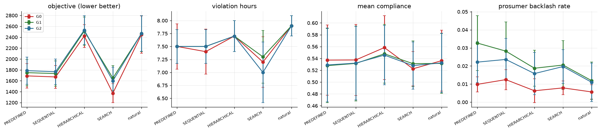

130 cells done over 10 backbone x seed blocks (backbones: deepseek_v4_pro, glm53).

**Cell means** (all backbones)

| plan | G0 | G1 | G2 |
|---|---|---|---|
| HIERARCHICAL | 2421.1 | 2504.3 | 2515.0 |
| PREDEFINED | 1702.8 | 1734.8 | 1765.2 |
| SEARCH | 1362.7 | 1648.4 | 1598.8 |
| SEQUENTIAL | 1682.1 | 1715.3 | 1742.2 |
| natural | 2522.7 | 2577.8 | 2580.5 |
_objective (lower is better)_

**Governance effect on the objective by plan** (paired over blocks, 95% bootstrap CI)

| contrast | plan | n | delta | lo | hi |
|---|---|---|---|---|---|
| G1-G0 | PREDEFINED | 8 | -5.2 | -86.1 | +76.7 |
| G1-G0 | SEQUENTIAL | 8 | -0.1 | -80.2 | +83.1 |
| G1-G0 | HIERARCHICAL | 8 | +11.0 | -63.0 | +90.6 |
| G1-G0 | SEARCH | 8 | +234.3 | +177.5 | +301.5 |
| G1-G0 | natural | 8 | +28.3 | -30.8 | +92.4 |
| G2-G0 | PREDEFINED | 8 | +25.1 | -76.4 | +113.8 |
| G2-G0 | SEQUENTIAL | 8 | +26.8 | -71.3 | +111.7 |
| G2-G0 | HIERARCHICAL | 8 | +12.9 | -62.0 | +99.3 |
| G2-G0 | SEARCH | 9 | +193.2 | +116.2 | +262.7 |
| G2-G0 | natural | 8 | +31.0 | -34.2 | +110.5 |

**plan x gov interaction** (randomised complete blocks; variance shares with block-bootstrap CI)

| outcome | n_blocks | share_plan | share_gov | share_int | share_int_lo | share_int_hi | F_int | p_int |
|---|---|---|---|---|---|---|---|---|
| objective | 6 | 0.761 | 0.004 | 0.009 | 0.008 | 0.014 | 0.342 | 0.946 |
| violation_hours | 6 | 0.147 | 0.010 | 0.039 | 0.007 | 0.231 | 0.427 | 0.901 |
| curtailed_kwh | 6 | 0.773 | 0.009 | 0.011 | 0.009 | 0.017 | 0.452 | 0.885 |
| mean_compliance | 6 | 0.014 | 0.001 | 0.023 | 0.006 | 0.165 | 0.210 | 0.988 |
| curtail_gini | 6 | 0.939 | 0.006 | 0.022 | 0.016 | 0.029 | 5.813 | 0.000 |
| persuasion_rate | 6 | 0.337 | 0.238 | 0.022 | 0.004 | 0.115 | 0.477 | 0.868 |
| backlash_rate | 6 | 0.215 | 0.192 | 0.055 | 0.035 | 0.257 | 0.898 | 0.523 |
| message_integrity | 6 | 0.236 | 0.445 | 0.117 | 0.107 | 0.173 | 5.062 | 0.000 |

- Interaction significant (p<0.05) for: curtail_gini, message_integrity.
- Delta_gov(G1-G0) on the objective ranges from -5.2 (PREDEFINED) to +234.3 (SEARCH).
- Natural planner chose a FEAR/URGENCY framing in 0% of G0 messages; judge-rated integrity G0 0.88 vs G1 0.90.

