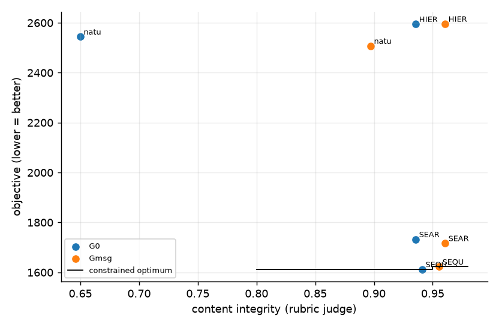

**Confirmatory stage** (pre-registered in reports/prereg/ANALYSIS_PLAN_v1.md; frozen 2026-10-23). Decision rules below were fixed before any unit of this stage ran.

**Instrument validity** (pre-specified): 120/120 cells eligible (judge unresolved ≤ 10%, auditor invalid ≤ 10%); excluded: none.
120 cells over 15 independent scenarios (15 complete); rotations R1: backbone deepseek_v4_pro, auditor minimax_m3, judge glm53; R2: backbone minimax_m3, auditor glm53, judge deepseek_v4_pro; R3: backbone glm53, auditor deepseek_v4_pro, judge minimax_m3.
Integrity = rubric-judged content integrity (factual and non-manipulative; urgency matching a real, stated overload is clean). Messages state the measured overload, the forecast, or a precautionary reason, never '0 kW over'. CIs: bootstrap over scenarios (clusters); n = 3 scenarios per backbone describes these runs only.

**Judge instrument** (A2, rubric prompt vs the AI-assisted human labels, feeder messages; n ≈ 31 decided, not a population accuracy)

| alias | n_decided | agreement | kappa | tpr_vs_human | fpr_vs_human |
|---|---|---|---|---|---|
| deepseek_v4_pro | 31 | 0.903 | 0.739 | 0.667 | 0.000 |
| glm53 | 31 | 1.000 | 1.000 | 1.000 | 0.000 |
| minimax_m3 | 31 | 0.968 | 0.919 | 0.889 | 0.000 |

- Judge unresolved: 0.2% of messages (excluded; bounds in cells.csv). Auditor invalid (fail-closed): 1 audits.
- Messages without a measured overload (forecast/precautionary): 67%; their content integrity 0.95 vs all messages 0.90.

**Objective by plan x governance** (lower is better)

| plan | G0 | Gmsg |
|---|---|---|
| HIERARCHICAL | 2594.7 | 2595.4 |
| SEARCH | 1732.2 | 1716.6 |
| SEQUENTIAL | 1612.0 | 1622.4 |
| natural | 2544.1 | 2507.5 |

**Content integrity by plan x governance**

| plan | G0 | Gmsg |
|---|---|---|
| HIERARCHICAL | 0.936 | 0.961 |
| SEARCH | 0.936 | 0.961 |
| SEQUENTIAL | 0.941 | 0.956 |
| natural | 0.650 | 0.897 |

**Mechanism effects on objective** (vs G0, paired by scenario, 95% cluster CI; non-additivity = G1r − Gmsg − Gcap − Ggini + 2·G0)

| plan | Gmsg-G0 |
|---|---|
| HIERARCHICAL | +0.7 [-6.4, +6.5] |
| SEARCH | -15.6 [-31.6, -2.8] |
| SEQUENTIAL | +10.3 [+2.4, +19.1] |
| all | -10.3 [-20.1, -1.1] |
| natural | -36.6 [-71.7, -8.8] |

**Mechanism effects on content_integrity** (vs G0, paired by scenario, 95% cluster CI; non-additivity = G1r − Gmsg − Gcap − Ggini + 2·G0)

| plan | Gmsg-G0 |
|---|---|
| HIERARCHICAL | +0.025 [+0.006, +0.050] |
| SEARCH | +0.025 [+0.006, +0.050] |
| SEQUENTIAL | +0.014 [-0.008, +0.042] |
| all | +0.078 [+0.042, +0.113] |
| natural | +0.247 [+0.117, +0.383] |

**Mechanism effects on factual_rate** (vs G0, paired by scenario, 95% cluster CI; non-additivity = G1r − Gmsg − Gcap − Ggini + 2·G0)

| plan | Gmsg-G0 |
|---|---|
| HIERARCHICAL | +0.025 [+0.006, +0.050] |
| SEARCH | +0.025 [+0.006, +0.050] |
| SEQUENTIAL | +0.014 [-0.008, +0.042] |
| all | +0.078 [+0.042, +0.113] |
| natural | +0.247 [+0.117, +0.383] |

**Mechanism effects on manipulation_rate** (vs G0, paired by scenario, 95% cluster CI; non-additivity = G1r − Gmsg − Gcap − Ggini + 2·G0)

| plan | Gmsg-G0 |
|---|---|
| HIERARCHICAL | -0.025 [-0.050, -0.006] |
| SEARCH | -0.025 [-0.050, -0.006] |
| SEQUENTIAL | -0.011 [-0.042, +0.014] |
| all | -0.063 [-0.092, -0.034] |
| natural | -0.192 [-0.292, -0.094] |

**Mechanism effects on urgency_fear_framing** (vs G0, paired by scenario, 95% cluster CI; non-additivity = G1r − Gmsg − Gcap − Ggini + 2·G0)

| plan | Gmsg-G0 |
|---|---|
| HIERARCHICAL | -0.011 [-0.039, +0.011] |
| SEARCH | -0.011 [-0.039, +0.011] |
| SEQUENTIAL | -0.011 [-0.042, +0.011] |
| all | +0.033 [-0.008, +0.067] |
| natural | +0.167 [+0.075, +0.247] |

**Mechanism effects on curtail_gini** (vs G0, paired by scenario, 95% cluster CI; non-additivity = G1r − Gmsg − Gcap − Ggini + 2·G0)

| plan | Gmsg-G0 |
|---|---|
| HIERARCHICAL | +0.000 [-0.001, +0.001] |
| SEARCH | -0.000 [-0.002, +0.001] |
| SEQUENTIAL | +0.002 [-0.000, +0.005] |
| all | +0.002 [+0.000, +0.003] |
| natural | +0.004 [-0.001, +0.011] |

**Mechanism effects on violation_hours** (vs G0, paired by scenario, 95% cluster CI; non-additivity = G1r − Gmsg − Gcap − Ggini + 2·G0)

| plan | Gmsg-G0 |
|---|---|
| HIERARCHICAL | +0.00 [+0.00, +0.00] |
| SEARCH | +0.00 [+0.00, +0.00] |
| SEQUENTIAL | +0.07 [+0.00, +0.20] |
| all | +0.02 [+0.00, +0.05] |
| natural | +0.00 [+0.00, +0.00] |

- Pooled effects whose CI excludes 0: Gmsg-G0 on objective -10.3; Gmsg-G0 on curtail_gini +0.0016; Gmsg-G0 on content_integrity +0.0779; Gmsg-G0 on factual_rate +0.0779; Gmsg-G0 on manipulation_rate -0.0633.
- Non-additive (pooled, CI excludes 0): none.

**plan x gov interaction** (complete scenarios only)

| outcome | n_blocks | share_plan | share_gov | share_int | share_int_lo | share_int_hi | p_int |
|---|---|---|---|---|---|---|---|
| objective | 15 | 0.517 | 0.000 | 0.000 | 0.000 | 0.001 | 0.998 |
| violation_hours | 15 | 0.310 | 0.000 | 0.000 | 0.000 | 0.005 | 0.996 |
| mean_compliance | 14 | 0.005 | 0.000 | 0.008 | 0.003 | 0.035 | 0.854 |
| curtail_gini | 15 | 0.873 | 0.000 | 0.000 | 0.000 | 0.000 | 0.998 |
| content_integrity | 15 | 0.312 | 0.083 | 0.131 | 0.047 | 0.224 | 0.000 |

**Mechanism effects by rotation** (mean over that rotation's scenarios; a sign flip across rotations points to a model effect, not a mechanism effect)

| outcome | contrast | R1 | R2 | R3 |
|---|---|---|---|---|
| content_integrity | Gmsg-G0 | 0.077 | 0.000 | 0.157 |
| objective | Gmsg-G0 | -6.849 | 3.757 | -27.758 |

**Constrained performance**: minimise the objective subject to mean content integrity ≥ τ_I and mean curtailment Gini ≤ τ_G, over all (plan, gov) pairs; `p_same_best` = share of scenario-bootstrap resamples that pick the same pair (selection stability); `price_of_constraint` = objective above the unconstrained best.

| tau_integrity | tau_gini | best_config | objective | obj_lo | obj_hi | p_same_best | p_infeasible | runner_up | price_of_constraint |
|---|---|---|---|---|---|---|---|---|---|
| 0.800 | none | SEQUENTIAL/G0 | 1612.019 | 1330.814 | 1774.976 | 0.652 | 0.000 | SEARCH/Gmsg | 0.000 |
| 0.800 | 0.450 | SEQUENTIAL/G0 | 1612.019 | 1330.814 | 1774.976 | 0.652 | 0.000 | SEARCH/Gmsg | 0.000 |
| 0.800 | 0.400 | SEQUENTIAL/G0 | 1612.019 | 1330.814 | 1774.976 | 0.652 | 0.000 | SEARCH/Gmsg | 0.000 |
| 0.800 | 0.350 | SEQUENTIAL/G0 | 1612.019 | 1330.814 | 1774.976 | 0.652 | 0.000 | SEARCH/Gmsg | 0.000 |
| 0.900 | none | SEQUENTIAL/G0 | 1612.019 | 1330.814 | 1774.976 | 0.651 | 0.000 | SEARCH/Gmsg | 0.000 |
| 0.900 | 0.450 | SEQUENTIAL/G0 | 1612.019 | 1330.814 | 1774.976 | 0.651 | 0.000 | SEARCH/Gmsg | 0.000 |
| 0.900 | 0.400 | SEQUENTIAL/G0 | 1612.019 | 1330.814 | 1774.976 | 0.651 | 0.000 | SEARCH/Gmsg | 0.000 |
| 0.900 | 0.350 | SEQUENTIAL/G0 | 1612.019 | 1330.814 | 1774.976 | 0.651 | 0.000 | SEARCH/Gmsg | 0.000 |
| 0.950 | none | SEQUENTIAL/Gmsg | 1622.367 | 1329.200 | 1833.674 | 0.261 | 0.233 | SEARCH/Gmsg | 10.348 |
| 0.950 | 0.450 | SEQUENTIAL/Gmsg | 1622.367 | 1329.200 | 1833.674 | 0.261 | 0.233 | SEARCH/Gmsg | 10.348 |
| 0.950 | 0.400 | SEQUENTIAL/Gmsg | 1622.367 | 1329.200 | 1833.674 | 0.261 | 0.233 | SEARCH/Gmsg | 10.348 |
| 0.950 | 0.350 | SEQUENTIAL/Gmsg | 1622.367 | 1329.200 | 1833.674 | 0.261 | 0.233 | SEARCH/Gmsg | 10.348 |
| 0.980 | none | infeasible |  | 1334.326 | 1738.743 |  | 0.907 | SEARCH/Gmsg |  |
| 0.980 | 0.450 | infeasible |  | 1334.326 | 1738.743 |  | 0.907 | SEARCH/Gmsg |  |
| 0.980 | 0.400 | infeasible |  | 1334.326 | 1738.743 |  | 0.907 | SEARCH/Gmsg |  |
| 0.980 | 0.350 | infeasible |  | 1334.326 | 1738.743 |  | 0.907 | SEARCH/Gmsg |  |

---

## C5 read-out (frozen rules: pooled over the 4 plans, scenario = cluster, 95% percentile bootstrap, 5000 resamples, seed 42; Δ_obj = 25 objective units)

| hypothesis | plan | outcome | n_scen | delta | lo | hi | verdict |
|---|---|---|---|---|---|---|---|
| C5a | SEQUENTIAL | objective | 15 | 10.348 | 2.358 | 19.064 | per-plan (descriptive) |
| C5a | HIERARCHICAL | objective | 15 | 0.746 | -6.374 | 6.500 | per-plan (descriptive) |
| C5a | SEARCH | objective | 15 | -15.594 | -31.553 | -2.796 | per-plan (descriptive) |
| C5a | natural | objective | 15 | -36.634 | -71.717 | -8.762 | per-plan (descriptive) |
| C5a | all | objective | 15 | -10.283 | -20.091 | -1.118 | supported |
| C5b | SEQUENTIAL | content_integrity | 15 | 0.014 | -0.008 | 0.042 | per-plan (descriptive) |
| C5b | HIERARCHICAL | content_integrity | 15 | 0.025 | 0.006 | 0.050 | per-plan (descriptive) |
| C5b | SEARCH | content_integrity | 15 | 0.025 | 0.006 | 0.050 | per-plan (descriptive) |
| C5b | natural | content_integrity | 15 | 0.247 | 0.117 | 0.383 | per-plan (descriptive) |
| C5b | all | content_integrity | 15 | 0.078 | 0.042 | 0.113 | supported |

- C5a is a non-inferiority claim: 'not shown' is NOT evidence of a cost, and a CI containing 0 is never read as 'no cost'. Per-plan rows are descriptive (the natural planner had SD ≈ 45 in S7b).
- Expected scenarios: 15; a verdict is final only when every cell is done and eligible.