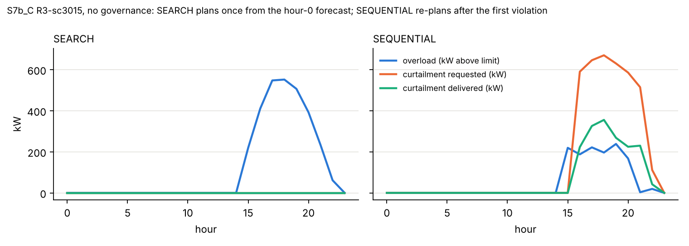
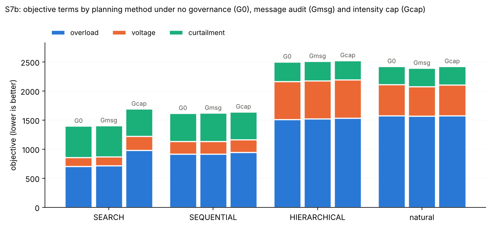

# P1: why the planning methods differ (RR_PLAN_v2, descriptive, no API calls)

Objective = overload + voltage + curtailment (overload = energy above the feeder import limit, kWh; voltage = 4000 × summed voltage-limit violation; curtailment = 0.25 × curtailed kWh). Lower is better. Eligible cells only (each study's validity rules). CIs: bootstrap over scenarios (5000, seed 42).

## P1a. Objective terms by plan and governance

**S7b_C**

| plan | gov | objective | overload | voltage | curtailment | curtailed_kwh | mean_compliance | revisions | gov_household_capped | gov_msg_rewrites |
|---|---|---|---|---|---|---|---|---|---|---|
| SEARCH | G0 | 1732.2 | 874.8 | 357.8 | 499.7 | 1998.7 | 0.5 | 0.0 |  |  |
| SEARCH | Gmsg | 1716.6 | 861.8 | 351.9 | 502.9 | 2011.7 | 0.5 | 0.0 | 0.0 | 1.6 |
| SEQUENTIAL | G0 | 1612.0 | 874.2 | 235.3 | 502.5 | 2010.1 | 0.5 | 6.6 |  |  |
| SEQUENTIAL | Gmsg | 1622.4 | 884.2 | 238.3 | 499.8 | 1999.3 | 0.5 | 6.7 | 0.0 | 1.7 |
| HIERARCHICAL | G0 | 2594.7 | 1545.1 | 717.2 | 332.4 | 1329.6 | 0.5 | 7.0 |  |  |
| HIERARCHICAL | Gmsg | 2595.4 | 1547.4 | 716.2 | 331.9 | 1327.6 | 0.5 | 7.0 | 0.0 | 1.6 |
| natural | G0 | 2544.1 | 1592.0 | 634.9 | 317.2 | 1268.7 | 0.5 | 9.0 |  |  |
| natural | Gmsg | 2507.5 | 1572.8 | 612.7 | 322.0 | 1287.9 | 0.5 | 9.0 | 0.0 | 8.7 |

**S7b_mechanism_ablation**

| plan | gov | objective | overload | voltage | curtailment | curtailed_kwh | mean_compliance | revisions | gov_household_capped | gov_msg_rewrites |
|---|---|---|---|---|---|---|---|---|---|---|
| SEARCH | G0 | 1396.8 | 705.0 | 153.1 | 538.8 | 2155.1 | 0.5 | 0.0 |  |  |
| SEARCH | Gmsg | 1405.3 | 717.0 | 153.4 | 534.9 | 2139.6 | 0.5 | 0.0 | 0.0 | 1.7 |
| SEARCH | Gcap | 1691.9 | 980.5 | 244.0 | 467.4 | 1869.7 | 0.5 | 0.0 | 213.8 | 0.0 |
| SEARCH | Ggini | 1452.1 | 755.0 | 171.0 | 526.1 | 2104.4 | 0.5 | 0.0 | 0.0 | 0.0 |
| SEARCH | G1r | 1702.3 | 998.5 | 240.6 | 463.2 | 1852.7 | 0.5 | 0.0 | 213.8 | 1.7 |
| SEQUENTIAL | G0 | 1617.0 | 916.5 | 214.8 | 485.7 | 1942.9 | 0.5 | 6.8 |  |  |
| SEQUENTIAL | Gmsg | 1620.9 | 917.9 | 217.2 | 485.8 | 1943.3 | 0.5 | 6.7 | 0.0 | 1.7 |
| SEQUENTIAL | Gcap | 1642.0 | 942.4 | 220.6 | 479.0 | 1915.9 | 0.5 | 6.8 | 0.0 | 0.0 |
| SEQUENTIAL | Ggini | 1626.3 | 914.4 | 225.3 | 486.7 | 1946.8 | 0.5 | 6.7 | 0.0 | 0.0 |
| SEQUENTIAL | G1r | 1681.3 | 963.8 | 242.4 | 475.0 | 1900.0 | 0.5 | 6.7 | 0.0 | 1.7 |
| HIERARCHICAL | G0 | 2501.8 | 1512.6 | 653.3 | 336.0 | 1343.8 | 0.5 | 7.1 |  |  |
| HIERARCHICAL | Gmsg | 2511.7 | 1519.0 | 658.2 | 334.5 | 1337.8 | 0.5 | 7.1 | 0.0 | 1.8 |
| HIERARCHICAL | Gcap | 2525.2 | 1532.4 | 662.1 | 330.7 | 1323.0 | 0.6 | 7.2 | 0.0 | 0.0 |
| HIERARCHICAL | Ggini | 2459.5 | 1504.8 | 619.0 | 335.6 | 1342.3 | 0.5 | 7.1 | 0.0 | 0.0 |
| HIERARCHICAL | G1r | 2526.4 | 1545.8 | 655.9 | 324.7 | 1298.8 | 0.5 | 7.3 | 0.0 | 1.7 |
| natural | G0 | 2424.0 | 1576.2 | 531.6 | 316.2 | 1264.7 | 0.5 | 8.3 |  |  |
| natural | Gmsg | 2394.1 | 1567.0 | 508.8 | 318.3 | 1273.2 | 0.5 | 8.4 | 0.0 | 9.9 |
| natural | Gcap | 2423.2 | 1575.2 | 531.6 | 316.4 | 1265.7 | 0.5 | 8.3 | 0.0 | 0.0 |
| natural | Ggini | 2441.9 | 1584.8 | 543.1 | 314.0 | 1256.1 | 0.5 | 8.3 | 0.0 | 0.0 |
| natural | G1r | 2456.6 | 1594.1 | 550.9 | 311.5 | 1246.0 | 0.5 | 8.4 | 0.0 | 9.9 |

**S7c_nonresponse**

| plan | gov | objective | overload | voltage | curtailment | curtailed_kwh | mean_compliance | revisions | gov_household_capped | gov_msg_rewrites |
|---|---|---|---|---|---|---|---|---|---|---|
| SEARCH | G0 | 1725.5 | 870.8 | 354.1 | 500.7 | 2002.7 | 0.5 | 0.0 |  |  |
| SEARCH | Gmsg | 1726.9 | 872.6 | 354.1 | 500.2 | 2000.9 | 0.5 | 0.0 | 0.0 | 1.6 |
| SEQUENTIAL | G0 | 1614.1 | 878.6 | 234.1 | 501.4 | 2005.5 | 0.5 | 6.6 |  |  |
| SEQUENTIAL | Gmsg | 1617.6 | 880.1 | 236.4 | 501.2 | 2004.6 | 0.5 | 6.7 | 0.0 | 1.6 |
| HIERARCHICAL | G0 | 2595.5 | 1546.1 | 717.2 | 332.2 | 1328.7 | 0.5 | 7.0 |  |  |
| HIERARCHICAL | Gmsg | 2595.4 | 1547.4 | 716.2 | 331.9 | 1327.6 | 0.5 | 7.0 | 0.0 | 1.6 |
| natural | G0 | 2543.2 | 1591.9 | 634.1 | 317.2 | 1268.8 | 0.5 | 9.0 |  |  |
| natural | Gmsg | 2504.3 | 1570.6 | 611.1 | 322.5 | 1290.1 | 0.5 | 9.0 | 0.0 | 8.7 |

## P1b. Plan differences without governance (G0), paired by scenario

| study | contrast | outcome | delta | ci | n_scenarios |
|---|---|---|---|---|---|
| S7b_C | SEARCH − SEQUENTIAL | objective | 120.2 | [-155.8, +594.1] | 15 |
| S7b_C | SEARCH − SEQUENTIAL | overload | 0.6 | [-164.7, +263.2] | 15 |
| S7b_C | SEARCH − SEQUENTIAL | voltage | 122.5 | [-35.6, +402.1] | 15 |
| S7b_C | SEARCH − SEQUENTIAL | curtailment | -2.8 | [-69.3, +43.0] | 15 |
| S7b_C | SEARCH − HIERARCHICAL | objective | -862.5 | [-1160.5, -372.9] | 15 |
| S7b_C | SEARCH − HIERARCHICAL | overload | -670.3 | [-844.6, -410.0] | 15 |
| S7b_C | SEARCH − HIERARCHICAL | voltage | -359.4 | [-566.9, -52.1] | 15 |
| S7b_C | SEARCH − HIERARCHICAL | curtailment | 167.3 | [+101.2, +214.5] | 15 |
| S7b_C | SEQUENTIAL − HIERARCHICAL | objective | -982.7 | [-1087.5, -872.2] | 15 |
| S7b_C | SEQUENTIAL − HIERARCHICAL | overload | -670.9 | [-716.9, -621.4] | 15 |
| S7b_C | SEQUENTIAL − HIERARCHICAL | voltage | -481.9 | [-573.3, -388.0] | 15 |
| S7b_C | SEQUENTIAL − HIERARCHICAL | curtailment | 170.1 | [+157.2, +181.7] | 15 |
| S7b_C | SEARCH − natural | objective | -811.9 | [-1227.3, -311.3] | 15 |
| S7b_C | SEARCH − natural | overload | -717.2 | [-998.2, -410.9] | 15 |
| S7b_C | SEARCH − natural | voltage | -277.1 | [-494.0, +4.1] | 15 |
| S7b_C | SEARCH − natural | curtailment | 182.5 | [+102.4, +257.6] | 15 |
| S7b_mechanism_ablation | SEARCH − SEQUENTIAL | objective | -220.2 | [-292.0, -158.1] | 9 |
| S7b_mechanism_ablation | SEARCH − SEQUENTIAL | overload | -211.5 | [-264.0, -165.0] | 9 |
| S7b_mechanism_ablation | SEARCH − SEQUENTIAL | voltage | -61.7 | [-105.2, -18.0] | 9 |
| S7b_mechanism_ablation | SEARCH − SEQUENTIAL | curtailment | 53.0 | [+41.1, +66.7] | 9 |
| S7b_mechanism_ablation | SEARCH − HIERARCHICAL | objective | -1105.0 | [-1285.7, -926.8] | 9 |
| S7b_mechanism_ablation | SEARCH − HIERARCHICAL | overload | -807.6 | [-900.9, -723.3] | 9 |
| S7b_mechanism_ablation | SEARCH − HIERARCHICAL | voltage | -500.2 | [-626.9, -367.4] | 9 |
| S7b_mechanism_ablation | SEARCH − HIERARCHICAL | curtailment | 202.8 | [+180.2, +227.3] | 9 |
| S7b_mechanism_ablation | SEQUENTIAL − HIERARCHICAL | objective | -884.8 | [-1022.3, -753.4] | 9 |
| S7b_mechanism_ablation | SEQUENTIAL − HIERARCHICAL | overload | -596.1 | [-660.1, -539.0] | 9 |
| S7b_mechanism_ablation | SEQUENTIAL − HIERARCHICAL | voltage | -438.5 | [-533.2, -341.6] | 9 |
| S7b_mechanism_ablation | SEQUENTIAL − HIERARCHICAL | curtailment | 149.8 | [+133.8, +167.4] | 9 |
| S7b_mechanism_ablation | SEARCH − natural | objective | -1027.1 | [-1307.8, -743.2] | 9 |
| S7b_mechanism_ablation | SEARCH − natural | overload | -871.2 | [-1097.4, -627.8] | 9 |
| S7b_mechanism_ablation | SEARCH − natural | voltage | -378.5 | [-499.6, -265.0] | 9 |
| S7b_mechanism_ablation | SEARCH − natural | curtailment | 222.6 | [+159.9, +283.2] | 9 |
| S7c_nonresponse | SEARCH − SEQUENTIAL | objective | 111.4 | [-167.1, +586.5] | 15 |
| S7c_nonresponse | SEARCH − SEQUENTIAL | overload | -7.8 | [-177.0, +255.3] | 15 |
| S7c_nonresponse | SEARCH − SEQUENTIAL | voltage | 119.9 | [-37.4, +400.2] | 15 |
| S7c_nonresponse | SEARCH − SEQUENTIAL | curtailment | -0.7 | [-67.2, +46.4] | 15 |
| S7c_nonresponse | SEARCH − HIERARCHICAL | objective | -869.9 | [-1170.3, -378.8] | 15 |
| S7c_nonresponse | SEARCH − HIERARCHICAL | overload | -675.3 | [-853.0, -413.0] | 15 |
| S7c_nonresponse | SEARCH − HIERARCHICAL | voltage | -363.1 | [-569.9, -56.1] | 15 |
| S7c_nonresponse | SEARCH − HIERARCHICAL | curtailment | 168.5 | [+102.0, +216.6] | 15 |
| S7c_nonresponse | SEQUENTIAL − HIERARCHICAL | objective | -981.3 | [-1087.9, -868.9] | 15 |
| S7c_nonresponse | SEQUENTIAL − HIERARCHICAL | overload | -667.5 | [-713.1, -617.6] | 15 |
| S7c_nonresponse | SEQUENTIAL − HIERARCHICAL | voltage | -483.1 | [-574.6, -388.9] | 15 |
| S7c_nonresponse | SEQUENTIAL − HIERARCHICAL | curtailment | 169.2 | [+156.2, +180.8] | 15 |
| S7c_nonresponse | SEARCH − natural | objective | -817.6 | [-1236.2, -317.4] | 15 |
| S7c_nonresponse | SEARCH − natural | overload | -721.1 | [-1003.8, -415.3] | 15 |
| S7c_nonresponse | SEARCH − natural | voltage | -280.0 | [-497.5, +2.3] | 15 |
| S7c_nonresponse | SEARCH − natural | curtailment | 183.5 | [+102.8, +259.3] | 15 |

- S7b_C: scenarios won under G0: SEARCH 10, SEQUENTIAL 5; mean objective by rotation (backbone):

| rot | HIERARCHICAL | SEARCH | SEQUENTIAL | natural |
|---|---|---|---|---|
| R1 | 2899.8 | 1799.9 | 1891.0 | 2588.9 |
| R2 | 2411.5 | 1331.2 | 1442.6 | 2053.1 |
| R3 | 2472.7 | 2065.6 | 1502.4 | 2990.2 |

- S7b_mechanism_ablation: scenarios won under G0: SEARCH 9; mean objective by rotation (backbone):

| rot | HIERARCHICAL | SEARCH | SEQUENTIAL | natural |
|---|---|---|---|---|
| R1 | 2757.2 | 1546.8 | 1769.0 | 2213.3 |
| R2 | 2538.5 | 1382.2 | 1639.4 | 2329.4 |
| R3 | 2209.8 | 1261.5 | 1442.8 | 2729.1 |

- S7c_nonresponse: scenarios won under G0: SEARCH 10, SEQUENTIAL 5; mean objective by rotation (backbone):

| rot | HIERARCHICAL | SEARCH | SEQUENTIAL | natural |
|---|---|---|---|---|
| R1 | 2899.8 | 1799.9 | 1891.0 | 2588.9 |
| R2 | 2413.8 | 1329.7 | 1446.2 | 2050.4 |
| R3 | 2472.7 | 2047.1 | 1505.1 | 2990.2 |

**SEARCH − SEQUENTIAL per scenario under G0** (sensitivity of the mean to the single most extreme scenario; descriptive, not a pre-specified test)

| study | n | mean | median | largest_abs_scenario | largest_abs_delta | mean_without_largest | ci_without_largest | search_better_count |
|---|---|---|---|---|---|---|---|---|
| S7b_C | 15 | 120.2 | -136.9 | R3-sc3015 | 3267.4 | -104.6 | [-173.9, -26.5] | 10 |
| S7b_mechanism_ablation | 9 | -220.2 | -222.6 | R2-sc2003 | -449.4 | -191.5 | [-240.5, -144.9] | 9 |
| S7c_nonresponse | 15 | 111.4 | -136.9 | R3-sc3015 | 3258.3 | -113.4 | [-189.3, -32.1] | 10 |

## P1e. Overload hours in which the plan requested nothing (G0, hourly traces)

SEARCH plans once at hour 0 from the forecast with a fixed compliance prior and no re-planning; SEQUENTIAL and HIERARCHICAL re-plan after a violation. An overload the hour-0 forecast did not show therefore stays unanswered under SEARCH.

| study | plan | cells | mean_overload_hours | mean_unanswered | cells_never_requesting |
|---|---|---|---|---|---|
| S7b_C | HIERARCHICAL | 15 | 7.0 | 0.1 | 0 |
| S7b_C | SEARCH | 15 | 6.5 | 0.5 | 1 |
| S7b_C | SEQUENTIAL | 15 | 6.6 | 0.1 | 0 |
| S7b_C | natural | 15 | 7.5 | 0.1 | 0 |
| S7b_mechanism_ablation | HIERARCHICAL | 9 | 7.1 | 0.0 | 0 |
| S7b_mechanism_ablation | SEARCH | 9 | 6.9 | 0.0 | 0 |
| S7b_mechanism_ablation | SEQUENTIAL | 9 | 6.8 | 0.0 | 0 |
| S7b_mechanism_ablation | natural | 9 | 7.6 | 0.0 | 0 |

SEARCH cells with overload but no request all day: S7b_C/R3-sc3015-SEARCH-G0

## P1c. What each governance mechanism changes, by plan (S7b, mechanism − G0, paired by scenario)

| mechanism | plan | objective | overload | voltage | curtailment | curtailed_kwh | household requests capped (per episode) |
|---|---|---|---|---|---|---|---|
| Gcap | HIERARCHICAL | +23.4 [+3.4, +51.0] | +19.8 [+8.1, +33.1] | +8.8 [-6.4, +29.1] | -5.2 [-8.4, -2.4] | -20.9 [-33.7, -9.5] | +0.0 |
| Gcap | SEARCH | +295.1 [+253.6, +344.9] | +275.5 [+246.4, +312.4] | +90.9 [+64.7, +118.0] | -71.3 [-80.4, -63.1] | -285.4 [-321.8, -252.4] | +213.8 |
| Gcap | SEQUENTIAL | +25.0 [-5.1, +59.7] | +26.0 [+5.7, +51.9] | +5.7 [-11.0, +22.7] | -6.7 [-13.2, -1.8] | -27.0 [-52.6, -7.0] | +0.0 |
| Gcap | natural | -0.7 [-2.2, +0.0] | -1.0 [-3.0, +0.0] | +0.0 [+0.0, +0.0] | +0.2 [+0.0, +0.7] | +1.0 [+0.0, +3.0] | +0.0 |
| Gmsg | HIERARCHICAL | +9.8 [+0.0, +23.3] | +6.5 [+0.0, +17.3] | +4.9 [+0.0, +11.7] | -1.5 [-4.3, +0.1] | -6.0 [-17.1, +0.5] | +0.0 |
| Gmsg | SEARCH | +8.5 [+0.5, +20.8] | +12.0 [+1.7, +27.9] | +0.3 [+0.0, +1.0] | -3.9 [-8.2, -0.4] | -15.4 [-32.7, -1.5] | +0.0 |
| Gmsg | SEQUENTIAL | +3.9 [-4.0, +12.7] | +1.4 [-7.1, +9.2] | +2.4 [+0.0, +7.2] | +0.1 [-2.1, +2.6] | +0.4 [-8.4, +10.4] | +0.0 |
| Gmsg | natural | -29.9 [-60.7, -4.7] | -9.2 [-18.7, -0.4] | -22.8 [-47.4, -3.2] | +2.1 [-0.4, +4.6] | +8.5 [-1.5, +18.5] | +0.0 |

## P1d. Planning scenario bank (S4b): objective terms, latency penalty and deadline misses

physics_terms = overload + voltage (S4b saved them as one total); latency_penalty = latency price × decision latency (zero in scenarios without a latency price).

**Winner per scenario** (lowest mean adjusted objective over seeds; margin = SEARCH − winner)

| split | family | scenario | mode | objective_adj | search_obj | margin_vs_search |
|---|---|---|---|---|---|---|
| train | baseline | base | SEARCH | 1468.4 | 1468.4 | 0.0 |
| train | forecast_shift | bias_over15 | SEARCH | 1319.8 | 1319.8 | 0.0 |
| train | forecast_shift | bias_under15 | SEARCH | 2445.6 | 2445.6 | 0.0 |
| train | search_budget | branch2 | SEARCH | 1513.9 | 1513.9 | 0.0 |
| train | search_budget | branch2_lat30 | SEARCH | 1596.4 | 1596.4 | 0.0 |
| train | deadline_cost | deadline4_lat20 | HIERARCHICAL | 1568.9 | 1905.8 | 336.9 |
| train | deadline_cost | deadline6_lat60 | PREDEFINED | 1701.5 | 1798.4 | 96.9 |
| heldout | compliance_drift | drift30 | SEARCH | 3828.9 | 3828.9 | 0.0 |
| heldout | feeder_structure | feeder_seed3 | SEARCH | 2485.3 | 2485.3 | 0.0 |
| train | deadline_cost | lat120 | PREDEFINED | 1761.5 | 2128.4 | 366.9 |
| heldout | feeder_structure | long3x14 | SEARCH | 29678.7 | 29678.7 | 0.0 |
| train | forecast_shift | noise25 | SEARCH | 1614.5 | 1614.5 | 0.0 |
| heldout | compliance_drift | resist50_drift15 | SEARCH | 2463.2 | 2463.2 | 0.0 |
| train | telemetry | telemetry20 | SEQUENTIAL | 1712.1 | 2770.4 | 1058.3 |
| train | telemetry | telemetry40 | SEQUENTIAL | 1818.9 | 2770.4 | 951.5 |
| heldout | feeder_structure | tightcap_weak | SEARCH | 4337.4 | 4337.4 | 0.0 |
| heldout | feeder_structure | wide6x7 | SEARCH | 1582.8 | 1582.8 | 0.0 |

**By scenario family and mode**

| family | mode | objective_adj | physics_terms | curtailment | latency_penalty | deadline_misses |
|---|---|---|---|---|---|---|
| baseline | HIERARCHICAL | 2453.7 | 2123.6 | 330.1 | 0.0 | 0.0 |
| baseline | PREDEFINED | 1641.5 | 1150.3 | 491.2 | 0.0 | 0.0 |
| baseline | SEARCH | 1468.4 | 930.0 | 538.4 | 0.0 | 0.0 |
| baseline | SEQUENTIAL | 1628.4 | 1133.7 | 494.7 | 0.0 | 0.0 |
| compliance_drift | HIERARCHICAL | 3825.2 | 3661.2 | 164.0 | 0.0 | 0.0 |
| compliance_drift | PREDEFINED | 3198.2 | 2965.9 | 232.4 | 0.0 | 0.0 |
| compliance_drift | SEARCH | 3146.0 | 2904.4 | 241.6 | 0.0 | 0.0 |
| compliance_drift | SEQUENTIAL | 3193.5 | 2955.6 | 237.9 | 0.0 | 0.0 |
| deadline_cost | HIERARCHICAL | 5220.6 | 1745.8 | 394.6 | 3080.1 | 0.0 |
| deadline_cost | PREDEFINED | 1708.2 | 1150.3 | 491.2 | 66.7 | 0.0 |
| deadline_cost | SEARCH | 1944.2 | 997.9 | 523.8 | 422.4 | 0.0 |
| deadline_cost | SEQUENTIAL | 2552.9 | 1133.7 | 494.7 | 924.4 | 0.0 |
| feeder_structure | HIERARCHICAL | 12872.6 | 12501.8 | 370.8 | 0.0 | 0.0 |
| feeder_structure | PREDEFINED | 10270.8 | 9695.6 | 575.2 | 0.0 | 0.0 |
| feeder_structure | SEARCH | 9521.0 | 8899.6 | 621.4 | 0.0 | 0.0 |
| feeder_structure | SEQUENTIAL | 10181.6 | 9595.6 | 586.0 | 0.0 | 0.0 |
| forecast_shift | HIERARCHICAL | 2634.3 | 2305.0 | 329.2 | 0.0 | 0.0 |
| forecast_shift | PREDEFINED | 1995.6 | 1534.0 | 461.5 | 0.0 | 0.0 |
| forecast_shift | SEARCH | 1793.3 | 1302.7 | 490.6 | 0.0 | 0.0 |
| forecast_shift | SEQUENTIAL | 2002.7 | 1538.0 | 464.7 | 0.0 | 0.0 |
| search_budget | HIERARCHICAL | 3219.2 | 2123.6 | 330.1 | 765.5 | 0.0 |
| search_budget | PREDEFINED | 1656.5 | 1150.3 | 491.2 | 15.0 | 0.0 |
| search_budget | SEARCH | 1555.2 | 990.3 | 523.6 | 41.2 | 0.0 |
| search_budget | SEQUENTIAL | 1836.4 | 1133.7 | 494.7 | 208.0 | 0.0 |
| telemetry | HIERARCHICAL | 2494.0 | 2178.3 | 315.7 | 0.0 | 0.0 |
| telemetry | PREDEFINED | 2867.4 | 2549.1 | 318.2 | 0.0 | 0.0 |
| telemetry | SEARCH | 2770.4 | 2429.1 | 341.3 | 0.0 | 0.0 |
| telemetry | SEQUENTIAL | 1765.5 | 1285.1 | 480.4 | 0.0 | 0.0 |

